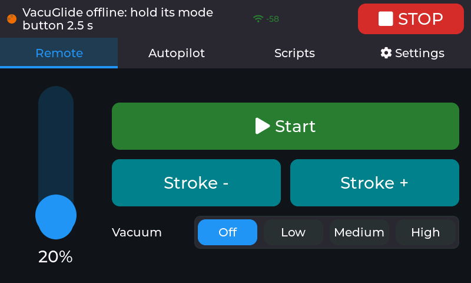
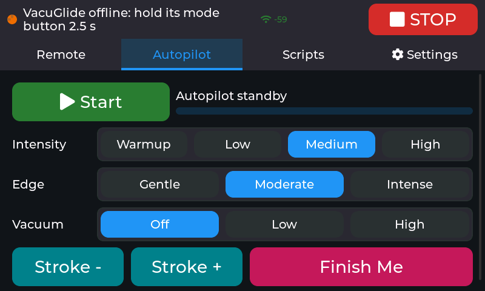
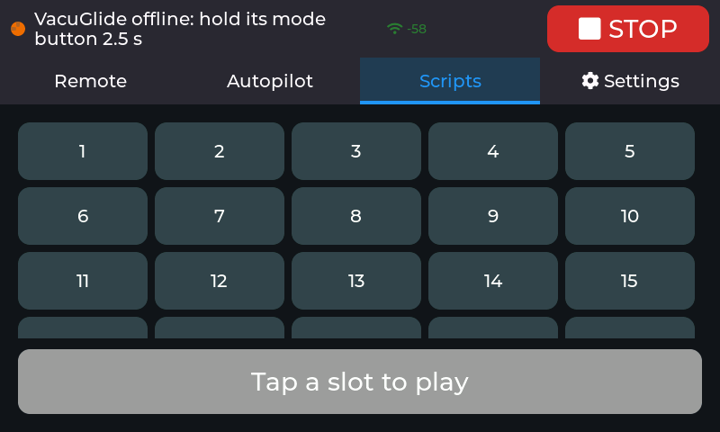

# vacuglide-panel

A standalone touchscreen remote for the **Autoblow VacuGlide**, running on a
**Guition JC8048W550** (ESP32-S3, 5" 800x480 touch display). It talks straight
to Autoblow's public device API with your device token. No phone, PC or
home-automation hub is needed once it's set up.

> Unofficial community project. Not made, endorsed or supported by Autoblow.
> "Autoblow" and "VacuGlide" are trademarks of their owners.

| Remote | Autopilot | Scripts |
|---|---|---|
|  |  |  |

Screenshots taken from the panel itself (`GET /screenshot`), with the VacuGlide switched off.

## What it does

- **Remote:** speed slider (5-100 %), Start/Pause, hold-to-open Stroke - /
  Stroke +, vacuum maintenance Off/Low/Medium/High.
- **Autopilot (edging):** an on-device generator, with Intensity, Edge,
  Vacuum and Finish Me. A session is 8 waves: each climbs to a peak, holds it,
  then drops to a rest. Peaks get higher as the session goes on; Edge sets how
  long the peaks and rests last. When a session ends, a new random one starts.
- **Scripts:** play any of the device's 30 local-script slots, pause/resume.
  Long-press a slot to give it a name (stored on the panel, since the API only
  knows slot numbers).
- **Settings:** Wi-Fi (with a network scan), password, device token, and
  screen timeout. Wi-Fi and token apply after "Save & restart".
- **Screen sleep:** backlight off after 1/5/15 idle minutes (default 5), only
  while nothing is running. The touch that wakes it does nothing else.
- **STOP** on every screen.
- **Connection problems, explained:** the top bar shows Wi-Fi signal strength
  and, when Wi-Fi is down, why (wrong password, network not found, signal lost).
  The panel retries from scratch every 20 s.

### Safety notes

- The panel controls the device through Autoblow's cloud. **If the panel loses
  its connection, it cannot stop the device.** It shows a red banner saying the
  VacuGlide may still be running, and sends STOP first as soon as it reconnects.
  Keep the device's own controls within reach.
- If the device drops off the cloud while running, the panel stops everything
  instead of resuming later.
- Saving settings or installing an update stops the device first.

## Build your own

Everything below is the exact hardware this panel runs on. Prices are what we
paid or saw in 2026 and change often.

### Parts

| # | Part | Where | ~Price | Notes |
|---|---|---|---|---|
| 1 | **Guition JC8048W550C** — ESP32-S3-N16R8, 5" 800×480 IPS, **capacitive** touch | [AliExpress](https://www.aliexpress.us/item/3256807009269027.html), [Surenoo](https://www.surenoo.com/products/23291185) (Guition reseller) | $17–30 | Pick the **capacitive** option (see below) |
| 2 | **1S LiPo, 3.7 V 3000 mAh, size 103665** (≈10 × 36 × 65 mm) with a **JST 1.25 mm** 2-pin plug | [Amazon B0CG1TCXVZ](https://www.amazon.com/dp/B0CG1TCXVZ) (sold as a Miyoo Mini battery) | ~$10–15 | Plugs straight into the board's BAT socket |
| 3 | **Case**: xTouch Pro enclosure for the Guition 5" | [USB-C variant](https://makerworld.com/en/models/1127192-xtouch-pro-usb-hole-variant) (recommended) or [official base with pogo-pin charging](https://makerworld.com/en/models/1016156-xtouch-pro-official-base-for-guition-5inch-lcd) | print it | See "Case" below |
| 4 | USB-C cable + a **2 A or better** USB charger | anywhere | — | The board charges and runs at the same time |
| 5 | Autoblow **VacuGlide** online, and its **device token** | [Autoblow developer docs](https://developers.autoblow.com/) | — | |

Optional, for a battery % on screen (see [Battery level](#battery-level-optional)):

| # | Part | Where | ~Price |
|---|---|---|---|
| 6 | Adafruit **MAX17048** fuel gauge, STEMMA QT | [Adafruit #5580](https://www.adafruit.com/product/5580) | $5.95 |
| 7 | STEMMA QT → male header cable (red 3.3 V, black GND, blue SDA, yellow SCL) | [Adafruit #4209](https://www.adafruit.com/product/4209) | $0.95 |
| 8 | 2 × **JST 1.25 mm ↔ JST-PH 2.0 mm** 2-pin adapters (the gauge has PH 2.0 ports; battery and board are 1.25 mm), or splice the wires | electronics/hobby shops | ~$5 |
| 9 | A **1.25 mm 4-pin** cable for the board's P4 connector, if your board didn't come with one | electronics shops | ~$3 |

### Getting the right board

Listings often sell all three versions on one page and default to the wrong one.
It's the right board when:

1. It's **Guition JC8048W550** (printed on the back of the board).
2. You picked **capacitive touch** → **JC8048W550C**. Not N (no touch) or R (resistive).
3. **ESP32-S3-N16R8** ("8M PSRAM 16M FLASH"), **800×480**, **ST7262** display driver.
4. The back has a **BAT** socket at the top right, next to the speaker socket.
   Look-alikes such as the Sunton ESP32-8048S050 may not have the battery circuit.

Guition's spec sheet: [JC8048W550 specifications (PDF)](https://www.guition.com/-download).

### What's on the board

- **Power:** an **IP5306** chip charges the battery from USB-C (~2 A), boosts it to
  5 V, runs the panel while charging, and cuts off when the cell is low.
  About 320 mA at 5 V while running.
- **BAT socket (P7):** JST 1.25 mm, **BAT− left, BAT+ right** (looking at the back,
  socket at the top). Check your battery's red wire goes to BAT+ before plugging in;
  a reversed cell can destroy the IP5306.
- **Battery button:** next to the P5 connector. A short press switches the panel on
  when it runs from the battery alone.
- **P4 connector** (from the community pinout; check the silkscreen): GND, 3.3 V,
  GPIO17, GPIO18. The panel uses it for the optional fuel gauge.
- Touch (GT911) is on I2C GPIO19/20; backlight on GPIO2.

### Case

The [xTouch Pro](https://makerworld.com/en/models/1127192-xtouch-pro-usb-hole-variant)
cases were made for this exact board (by the xTouch printer-screen project) and
print on any FDM printer.

- **USB-C variant (recommended):** the USB-C port stays reachable, so you can
  charge and, if ever needed, flash firmware over USB without opening the case.
- **Official base with pogo pins:** charges through magnetic pogo pins on a stand;
  needs the pogo-pin parts listed on its page, and the case has to come apart to
  reach USB.

Check the case's battery space fits your cell (the one above is ≈10 × 36 × 65 mm),
and keep the cell away from the IP5306 and its inductor (top right, near BAT): they
get warm while charging.

### Assembly

1. **Flash first** ([Flash the firmware](#flash-the-firmware) below) while the board is still bare on your desk.
2. Check battery polarity (red → BAT+), then plug the battery into **BAT**.
3. With USB unplugged, **press the battery button** briefly: the panel should start
   on battery. Plug USB-C in: it keeps running and charges.
4. Leave it charging for ~10 minutes and feel the battery: warm is fine, **hot means
   unplug** (the charger runs at ~2 A, about 0.7C for a 3000 mAh cell).
5. Fit the board and battery in the case.

### Battery level (optional)

The IP5306 has no data connection, so without extra hardware the panel can't
show the battery level (it runs fine without it). A MAX17048 (or MAX17043)
fuel gauge adds a battery % under the Wi-Fi signal, voltage on the Settings tab,
and a safety stop: **at 5 % or less on battery** the panel stops the VacuGlide
and won't run it until USB is plugged in, so it can't die and leave the device
running.

Wiring with the parts above:

1. Battery → adapter → the gauge's JST-PH port; the gauge's other JST-PH port →
   adapter → board **BAT**. The gauge passes power straight through.
2. Gauge STEMMA QT → cable #7 → board **P4**: red → 3.3 V, black → GND,
   blue (SDA) → GPIO17, yellow (SCL) → GPIO18.
   The touch bus (SDA GPIO19, SCL GPIO20) works too.

The panel finds the gauge on either bus by itself, also when plugged in later.
`GET /i2c` shows what answers (the gauge is at address 0x36).

> Gauge support is new and not yet tried with a real MAX17048; the display was
> tested with simulated readings. Reports welcome.

### Alternatives

If the Guition board isn't available to you, the closest board is the
[Waveshare ESP32-S3-Touch-LCD-5](https://www.waveshare.com/esp32-s3-touch-lcd-5.htm)
(the 800×480 version, **not** the 1024×600 "5B"; [on Amazon](https://www.amazon.com/waveshare-Capacitive-Development-Dual-Core-Resolution/dp/B0DD7N19FT)).
It has its own battery charger (CS8501, 580 mA) and the same kind of display,
but **this firmware doesn't support it yet**: it needs a port to its pins.

## Flash the firmware

You need [PlatformIO](https://platformio.org/) (CLI or the VS Code extension).

1. `cp include/secrets.example.h include/secrets.h` and fill it in. Wi-Fi and
   token are only defaults; you can also leave them and set them on the
   panel's Settings tab later.
2. Plug the panel in by USB (shows up as `/dev/ttyUSB0` on Linux).
3. `pio run -t upload && pio device monitor`

Back up the stock firmware first if you might want it back:
`esptool --port /dev/ttyUSB0 read-flash 0 0x1000000 stock.bin`

## Updates over Wi-Fi

`pio run -e ota -t upload` builds the firmware and sends it to the panel with
`./ota.sh` (HTTP basic auth: user `ota`, password `OTA_PASSWORD` from
`secrets.h`). The panel stops the VacuGlide, installs, and reboots.

**Safety net:** an update is written to the other firmware slot and only
switched to once it's complete and its checksum verifies, so a cut-off upload
leaves the old firmware running. The new firmware then runs on probation: it
must get onto Wi-Fi and run for 30 s. If it crashes before that, or isn't
confirmed within 3 minutes (frozen, no Wi-Fi), the panel goes back to the
previous firmware by itself. `ota.sh` waits and reports `OK: new firmware
confirmed` or `ROLLED BACK`. `GET /` shows the build time and `firmware:
confirmed/pending`. USB flashing always works as the last resort.

`ota.sh` sends to `OTA_HOST` from `secrets.h` (default `vgremote.local`, the
panel's mDNS name). Override with `PANEL_HOST=192.168.x.y` or a second argument.
If the panel sits on an isolated IoT network, allow your computer to reach it
on TCP port 80.

`GET /screenshot?tab=0..3` (same login) returns the screen as a BMP and can
switch tabs first: 0 Remote, 1 Autopilot, 2 Scripts, 3 Settings. Settings shows
your token, so don't share that one. `GET /i2c` lists the chips answering on the
touch bus and the P4 connector.

## How it's built

| File | What |
|---|---|
| `src/board.cpp` | RGB panel (esp_lcd, bounce buffer), GT911 touch, LVGL glue, backlight |
| `src/autoblow.cpp` | Network task: desired-state sync to the API, keep-alive HTTPS, state polling |
| `src/control.cpp` | Modes: remote, Autopilot generator, vacuum pulses, scripts, STOP |
| `src/ui.cpp` | LVGL screens |
| `src/wlan.cpp` | Wi-Fi connect, retry watchdog, disconnect reasons, signal, mDNS |
| `src/battery.cpp` | MAX17048/MAX17043 fuel gauge: auto-detect on either I2C bus, level, voltage |
| `src/settings.cpp` | NVS: Wi-Fi + token (override secrets.h), screen timeout, script names |
| `src/ota.cpp` | Firmware upload (`POST /update`), `/screenshot`, `/i2c`, status (`/`) |
| `src/rollback.cpp` | Update probation: confirm after 30 s healthy on Wi-Fi, else roll back |
| `src/lv_mem_psram.c` | LVGL heap in PSRAM, so widgets don't take internal RAM from TLS |

The UI only sets a *desired* state; a network task on the other core sends
whatever differs, one request at a time, and retries until it lands. STOP
forgets what was sent, so everything is resent.

## License

[CC BY-NC-SA 4.0](LICENSE): you may use, change and share this project for
**non-commercial** purposes, with credit, and anything you build from it must be
shared under the same license. Third-party components keep their own licenses;
see [THIRD_PARTY_NOTICES.md](THIRD_PARTY_NOTICES.md).
